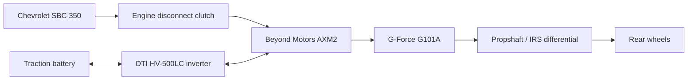

# Homemade Hybrid Drivetrain & Vehicle

I'm building a custom P2 hybrid drivetrain for a **Factory Five Gen 3 Type 65 Coupe**: a Chevrolet small-block V8, an electric motor between the engine and gearbox, and a conventional dog-engagement manual transmission.

This is my engineering notebook as the project develops. I want it to be useful if you're trying something similar, including the parts that didn't work. Each system has a current explanation, followed by dated experiments that describe the problem, what I tried, and what I learned.

**Current focus: [using a Gen 1 Bosch iBooster as a possible clutch actuator](systems/ibooster-gen1/README.md).** I can command movement on the bench, have characterized an apparent remote-travel ceiling, and have a practical power-cycle recovery method. The clutch installation and operation under clutch load are still ahead of me.

## What I'm building

That's the intended arrangement. I'm still developing the shaft support, couplings, clutch hydraulics, mounting, and control integration.

| System | My current direction | Where it stands |
| --- | --- | --- |
| Vehicle | Factory Five Gen 3 Type 65 Coupe | Intended platform |
| Engine | Naturally aspirated Chevrolet Gen I SBC 350, front-feed Holley Hi-Ram | Build specification developing |
| Electric motor | Beyond Motors AXM2, medium winding | Selected direction; installed capability unverified |
| Inverter | DTI HV-500LC | Selected; exact configuration and commissioning open |
| Transmission | Conventional G-Force G101A dog box, NASCAR gear set, 2.60 / 1.90 / 1.38 / 1.00 | Ratios from my project configuration |
| Battery | At least seven LG Chem Pacifica modules | Final count, module revision, and packaging open |
| ECU / hybrid supervisor | Ecumaster EMU Pro 16 | Selected architecture; control logic developing |
| Clutch actuator | Gen 1 Bosch iBooster, Tesla P1045523-00C | Bench investigation |
| Primary display | Ecumaster ADU5 | Selected direction |
| Supporting electronics | Dilithium BMS direction, power distribution still being specified, auxiliary Raspberry Pi display plus separate Android navigation/media | Mixed selected and provisional items |

These are my design choices, not a claim that everything is installed or validated. My [project baseline](docs/project-baseline.md) records the unresolved decisions, including the difference between the current seven-or-more-module battery intent and the older six-module packaging study.

## What I want it to do

I'm targeting about **425 crank hp** from the engine and using **7,000 rpm as a design ceiling**. Those are planning numbers, not dyno results or an approved limit for a finished engine.

I want electric launch and low-speed engine-off operation, followed by a transition into hybrid driving. The AXM2 would provide propulsion assistance and negative torque where the eventual battery, inverter, and thermal limits allow it. For shifting, I want to use motor torque to unload the gearbox dogs and match shaft speeds, with minimal interference in SBC operation. Routine ignition cuts or commanded engine-throttle reductions aren't my baseline strategy.

I haven't established combined output, vehicle mass, acceleration, top speed, electric range, or sustained hybrid output. My private virtual-dyno tool is useful for exploring assumptions, but its defaults and calculated outputs aren't vehicle specifications.

## Where to start reading

| Page | What you'll find |
| --- | --- |
| [Project baseline](docs/project-baseline.md) | Current choices and questions I still need to answer |
| [System index](systems/README.md) | Notes organized by subsystem |
| [iBooster overview](systems/ibooster-gen1/README.md) | The bench results and a route through the detailed notes |
| [iBooster bench workflow](systems/ibooster-gen1/bench-workflow.md) | Hardware, startup, logging, and how I judge whether control actually works |
| [Experiment notebook](systems/ibooster-gen1/experiments/README.md) | Problem → troubleshooting → findings, in order |
| [Documentation guide](docs/documentation-guide.md) | How I keep this notebook readable and traceable |
| [Experiment template](templates/experiment.md) | The format I use for new work |

I distinguish recorded bench results, my observations, interpretations, and plans throughout these pages. This remains a development project, with no validated vehicle controller or completed brake/clutch installation. I've published a small selection of derived bench data; the working software, full raw captures, CAD, and private conversations aren't included here.

Updated October 30, 2026.
