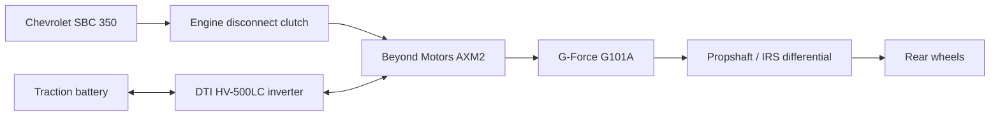

# Homemade Hybrid Drivetrain & Vehicle

I'm building a P2 hybrid drivetrain for a **Factory Five Gen 3 Type 65 Coupe**. The basic idea is to put an electric motor between a small-block Chevy and a four-speed dog box, keep a real clutch, and make the two power sources work together.

Why? Partly because the combination sounds ridiculous in a good way. More practically, I want a car that can drive on electric power at low speeds, use the V8 when I want it, and use the motor for assistance, regenerative braking, and gearbox speed matching. The difficult part is making all of that fit in a fairly short car without turning the drivetrain into an unserviceable science project.

This repository is my running engineering notebook. It covers the decisions, the dead ends, and the bench work—not just a parts list or a collection of finished results. **The car isn't finished, and a lot of the systems here have not been commissioned.**

## Start here

| If you're looking for... | Go here |
| --- | --- |
| A quick explanation of the drivetrain and the main design constraints | [The build and its layout](#what-im-building) |
| All the subsystems, including what's written up and what's still coming | [System map](systems/README.md) |
| Current component choices and unresolved decisions | [Project baseline](docs/project-baseline.md) |
| The motor-position sensor rabbit hole (resolver vs. custom Hall encoder) | [AXM2 position sensing](systems/motor-position-encoder/README.md) |
| CAN control, travel limits, and testing of the Tesla iBooster | [iBooster investigation](systems/ibooster-gen1/README.md) |
| How I separate measurements, interpretations, and plans | [Reading the test notes](docs/documentation-guide.md) |

## What I'm building

The P2 arrangement lets the electric motor drive the transmission with the engine disconnected. Once the clutch is engaged, the two can work together. It also gives me a way to use motor torque for dog-box unloading and speed matching without making routine ignition cuts the default shifting strategy.

The obvious downside: **there's a motor, clutch, adapters, supports, and a gearbox to fit into a space that wasn't designed for them.** Packaging has driven a surprising number of the decisions in this build.

### Main hardware

| Area | Current direction |
| --- | --- |
| Chassis | Factory Five Gen 3 Type 65 Coupe |
| Engine | Naturally aspirated Chevrolet Gen I 350 SBC; approximately 425 crank hp is the initial target, not a measured result |
| Engine disconnect | Conventional clutch between engine and AXM2 |
| Electric motor | Beyond Motors AXM2, medium-voltage winding |
| Inverter | DTI HV-500LC |
| Transmission | G-Force G101A, 2.60 / 1.90 / 1.38 / 1.00 |
| Battery | LG Chem Pacifica modules; at least seven currently planned |
| Engine and hybrid control | Ecumaster EMU Pro 16 |
| Clutch actuation | Tesla Gen 1 Bosch iBooster under bench investigation |
| Motor position feedback | Custom 20-pole, three-Hall encoder under development |
| Primary display | Ecumaster ADU5 |

These are project selections and design targets, not a claim that the entire system is assembled or proven. The [baseline](docs/project-baseline.md) is where I track changes in direction.

## What I want the car to do

I'm primarily building for track use, with electric torque filling in where it makes sense rather than chasing a single impressive combined horsepower number. I also want electric-only low-speed operation, useful regeneration, and control over how aggressively the motor helps in different modes.

My engine target is roughly **425 crank hp**. I'm using **7,000 rpm as a design ceiling** while the engine specification develops. Neither is a dyno result or a validated operating limit. Combined power, sustained assist, thermal performance, and actual vehicle behavior will need testing.

## What's actually documented

Right now, the deepest material is on two problems:

- **[iBooster control](systems/ibooster-gen1/README.md):** I've commanded movement on an unloaded bench assembly, measured a repeatable remote-travel limit, explored CAN fault/recovery behavior, and kept the individual experiments and derived data. Whether it will operate the clutch under load is still open.
- **[AXM2 rotor position](systems/motor-position-encoder/README.md):** I've compared resolver arrangements against the packaging and inverter constraints, designed an initial Hall PCB, and settled on a custom magnetic encoder as the direction to test. A working rotating encoder has not been demonstrated.

There's a lot more car to cover. The [system map](systems/README.md) includes the major areas I intend to document next; I won't create the appearance of a finished technical write-up by filling them with empty pages.

## A note about the evidence

I try to keep a clean line between **what I measured**, **what I think it means**, and **what I'm planning to try next**. If an experiment failed or a design changed, I want that recorded too. The latest overview describes the current direction; the dated notes preserve how I got there.

The repo contains selected documentation and derived bench data, not all of my working software, CAD, or raw captures.

*Project notes updated November 18, 2026.*
