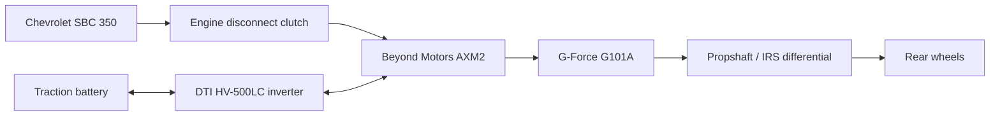

# Homemade Hybrid Drivetrain & Vehicle

Development of a custom P2 hybrid drivetrain and vehicle controls for a **Factory Five Gen 3 Type 65 (Daytona-style) Coupe**.

The project combines a Chevrolet small-block V8, an electric motor between the engine and gearbox, and a conventional manual dog-engagement transmission. This repository records the design, experiments, mistakes, and lessons learned as the vehicle develops.

**Current focus:** [controlling a Gen 1 Bosch iBooster as a potential clutch actuator](systems/ibooster-gen1/README.md).

## Vehicle architecture

This is the intended functional arrangement. Shaft support, couplings, clutch hydraulics, mounting, and control integration remain development work.

| System | Current direction | Status |
| --- | --- | --- |
| Vehicle | Factory Five Gen 3 Type 65 Coupe | Intended platform |
| Engine | Naturally aspirated Chevrolet Gen I SBC 350; front-feed Holley Hi-Ram intake | Build specification developing |
| Electric motor | Beyond Motors AXM2, medium winding | Selected direction; installed capability unverified |
| Inverter | DTI HV-500LC | Selected; exact configuration and commissioning open |
| Transmission | Conventional G-Force G101A dog box with NASCAR gear set; 2.60 / 1.90 / 1.38 / 1.00 ratios | Owner-supplied configuration |
| Battery | At least seven LG Chem Pacifica modules | Current intent; final count, revision, and packaging open |
| ECU / hybrid supervisor | Ecumaster EMU Pro 16 | Selected architecture; hybrid logic developing |
| Clutch actuation | Gen 1 Bosch iBooster, Tesla donor 1045523-00-C | Bench investigation; clutch installation unverified |
| Primary display | Ecumaster ADU5 | Selected direction |
| Supporting electronics | Dilithium BMS direction; power distribution still being specified; auxiliary Raspberry Pi display and separate Android navigation/media | Mixed selected and provisional items |

Selections describe project intent, not a claim that every component is purchased, installed, or validated. See [baseline and open questions](docs/project-baseline.md).

## Intended performance and behavior

- **Engine:** approximately **425 crank hp** target and a **7,000 rpm design ceiling**. These are planning targets; the finished engine and operating limit are unverified.
- **Electric driving:** explore electric launch and low-speed operation with the engine disconnected, followed by transition into hybrid operation.
- **Hybrid assistance:** use the AXM2 for positive propulsion torque and negative torque where the electrical system permits.
- **Shifting:** aim for mostly clutchless shifts using motor torque to unload the dogs and match shaft speeds, with minimal interference in SBC operation. Routine ignition cuts or commanded engine-throttle reductions are not the baseline intent.
- **Energy management:** coordinate assistance and regeneration within the eventual battery, inverter, and thermal limits.

Combined output, vehicle mass, acceleration, top speed, and electric range have not been established in the records used for this overview. Motor ratings and simulator outputs will be kept separate from measured installed performance.

A virtual-dyno development tool already exists in the working project; it has not been imported here. Its illustrative mass, final drive, battery characteristics, and calculated results are not vehicle specifications.

## Read the project

| Location | What belongs there |
| --- | --- |
| [Project baseline](docs/project-baseline.md) | Current major choices, performance intent, and unresolved decisions |
| [Documentation guide](docs/documentation-guide.md) | How to add systems, experiments, data, and references |
| [Systems](systems/README.md) | Technical topics organized by subsystem |
| [Gen 1 iBooster](systems/ibooster-gen1/README.md) | Current investigation and lessons learned |
| [Experiment template](templates/experiment.md) | A reusable record for a test or development session |

Start each new system with one README. Add hardware notes, code, diagrams, photos, and dated experiments when there is material to publish. The current summary should stay readable as the experiment history grows.

## Development status

This is an ongoing personal engineering project. Bench observations, simulations, and vehicle tests are identified separately. No road-ready controller, validated brake/clutch system, or fabrication release is provided here.

The initial documentation summarizes existing project notes and selected prior development discussions as of **October 30, 2026**. Original bench software, raw captures, CAD, and private conversations have not been imported.
